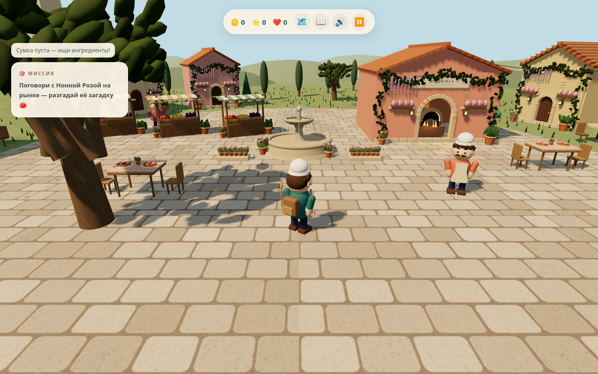

# Кухня Мира — Тоскана · визуальный прототип

3D-приключение: исследуй Тоскану, выполняй задания жителей, собирай ингредиенты, лови Критика Крюка, обслужи пять гостей и приготовь пиццу дома со взрослым.

## Кадр из игры



[Утверждённый концепт](preview/concept.png) · [Общий вид игровой сцены](preview/tuscany-overview.png) · [Что изменено](ART-REVIEW.md)

## Скачать визуальный прототип

[Скачать визуальную версию Тосканы](https://github.com/forchatgpt11091985-ctrl/game_cook/raw/refs/heads/art/tuscany-review/game-cook-tuscany-preview.zip)

Распакуйте архив целиком. Для готовой версии не нужны npm и Node.js.

## Запуск на Mac

1. Откройте скачанный ZIP двойным щелчком.
2. Откройте приложение **Терминал** (через Spotlight: Command + пробел → Терминал).
3. Введите `/bin/sh` и пробел. Перетащите файл `START-MAC-LINUX.command` из распакованной папки в окно терминала и нажмите Enter.
4. Игра откроется в браузере по адресу http://127.0.0.1:8765/ . Оставьте окно терминала открытым на время игры.

Нужен Python 3. Если команда python3 не найдена, установите его с [официального сайта](https://www.python.org/downloads/macos/) и повторите запуск. Загрузка готового HTML с диска может зависеть от настроек браузера; рекомендуемый способ — локальный сервер выше.

Если скачан весь репозиторий кнопкой **Code → Download ZIP**, файлы запуска находятся в `app/release/`.

## Визуальная версия Тосканы

Эта ветка содержит первый перенос утверждённого концепта в игровую сцену. Снимки из игры и художественный концепт оцениваются отдельно: уровень детальности концепта ещё не достигнут.

- Каменная мостовая с процедурными текстурами и рельефом.
- Арочные входы, черепичные крыши, ставни, горшки, глициния и фонари.
- Рынок с полосатыми навесами, ящиками и разными продуктами.
- Пиццерия с видимой печью; фонтан со струями воды; столики с пиццей.
- Обновлённые лица, одежда и рюкзак героя.
- Полноценный WebGL-рендерер, тёплый свет, тени и тональное отображение ACES.
- Статическая геометрия объединена по материалам; повторяющиеся листья, трава и черепица используют инстансинг.

Автоматического переключения на упрощённую графику в этой ветке нет. Для запуска нужен работающий WebGL на устройстве. Изменение сцены не исправляет блокировку WebGL браузером.

[Скачать визуальную версию](https://github.com/forchatgpt11091985-ctrl/game_cook/raw/refs/heads/art/tuscany-review/game-cook-tuscany-preview.zip)

## Windows

Откройте `START-WINDOWS.cmd` в распакованной папке. Запуск использует встроенный PowerShell. Веб-сервер доступен только на вашем компьютере. Windows-лаунчер подготовлен, но в Linux-среде не проверялся.

## Управление

WASD / стрелки — движение. Зажмите кнопку мыши и двигайте мышь для поворота камеры. E или кнопка подсказки — взаимодействие. P / Esc — пауза и продолжение. На сенсорном экране: левая половина — движение, правая — камера.

## Сохранения

Прогресс, дневник и фото сохраняются только в текущем браузере по текущему адресу. Фото никуда не отправляются. Фанаты — игровые, публичного блога нет. Реализована Италия; остальные страны обозначены на карте как будущие главы.

## Разработка

```sh
cd app
npm ci
npm run dev -- --host 0.0.0.0
```

Проверки и сборка:

```sh
npm run build
npm run build:standalone
npm run verify:chapter
```

Готовая автономная сборка — `app/release/index.html`. Подробнее: [отчёт об исправлениях](WORK-REPORT.md).
